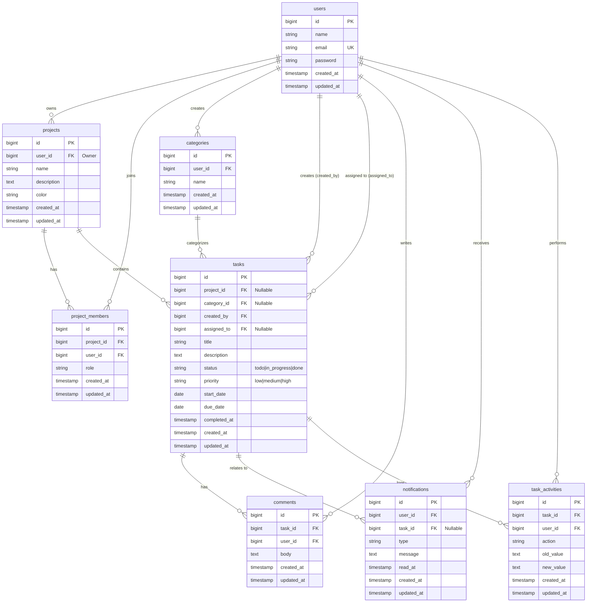

# TaskFlow — Smart To-Do List & Productivity Dashboard

TaskFlow adalah aplikasi manajemen tugas dan dashboard produktivitas berbasis web yang dirancang dengan arsitektur monolitik **Laravel 11**, **Blade**, **Tailwind CSS**, **Chart.js**, **FullCalendar**, dan **SortableJS**. Aplikasi ini mendukung penggunaan individu (tugas pribadi) maupun kolaborasi tim (proyek bersama, penugasan anggota, komentar, dan pelacakan riwayat aktivitas).

---

## 1. Arsitektur & Tech Stack

- **Backend Framework:** Laravel 11 (PHP 8.2+)
- **Arsitektur:** Monolitik Model-View-Controller (MVC) terintegrasi dengan Service Layer, Form Requests, dan Authorization Policies.
- **Database:** SQLite (default zero-config lokal & testing) serta 100% kompatibel dengan MySQL (lengkap dengan foreign key constraints, indexes, dan cascading rules).
- **Frontend Template:** Laravel Blade Template Engine.
- **Styling & UI:** Tailwind CSS dengan design tokens kustom (Primary: `#2F855A`, Background: `#F7F8FA`, Typography: Inter).
- **Interaktivitas Frontend:** Alpine.js, JavaScript Modern ES Modules via Vite.
- **Visualisasi & Analitik:** Chart.js (Grafik Produktivitas Mingguan & Distribusi Prioritas).
- **Manajemen Jadwal:** FullCalendar (Tampilan Bulan, Minggu, Daftar Agenda dengan endpoint JSON dinamis).
- **Kanban Board:** SortableJS dengan drag-and-drop real-time AJAX PATCH dan keyboard/dropdown fallback.
- **Autentikasi & Keamanan:** Laravel Breeze, CSRF Protection, Password Hashing (Bcrypt), Policy-based Authorization, Contextual Request Validation.
- **Testing:** PHPUnit / Laravel Test Runner dengan database in-memory isolated testing.

---

## 2. Fitur Utama

1. **Autentikasi & Profil Pengguna:**
   - Registrasi, Login, Logout, Remember Me, proteksi sesi.
   - Pengelolaan profil dan perubahan kata sandi terenkripsi.
2. **Dashboard Produktivitas Real-time:**
   - Kartu metrik: Total Tugas, Tugas Selesai, Persentase Penyelesaian, Tugas Berjalan, Deadline Kritis (Terlambat & Jatuh Tempo Segera).
   - Filter ringkasan berdasarkan konteks proyek tertentu atau seluruh tugas.
   - Grafik batang produktivitas 7 hari terakhir (tugas selesai vs tugas dibuat).
   - Diagram donat distribusi beban kerja berdasarkan prioritas (Tinggi, Sedang, Rendah).
   - Feed daftar tugas mendekati deadline dan aktivitas terbaru sistem.
3. **Manajemen Tugas Lengkap (CRUD):**
   - Atribut: Judul, deskripsi, proyek, kategori, pembuat, penanggung jawab, status (`todo`, `in_progress`, `done`), prioritas (`low`, `medium`, `high`), tanggal mulai, deadline, dan timestamp selesai.
   - Validasi bisnis: Tanggal mulai tidak boleh melampaui deadline.
   - Pencarian kata kunci judul & deskripsi.
   - Multi-filter: status, prioritas, proyek, kategori, dan kondisi deadline (terlambat / jatuh tempo segera).
   - Pengurutan dinamis & paginasi data.
4. **Kanban Board Interaktif:**
   - 3 Kolom alur kerja: **To Do**, **In Progress**, **Done**.
   - Pemindahan kartu menggunakan SortableJS drag-and-drop dengan umpan balik toast notification.
   - Kontrol alternatif dropdown status di setiap kartu untuk aksesibilitas penuh.
   - Penyimpanan langsung ke database dengan pencatatan timestamp penyelesaian otomatis.
5. **Kalender Deadline:**
   - FullCalendar terintegrasi dengan tampilan Bulanan, Mingguan, dan Daftar.
   - Penandaan warna acara berdasarkan status dan urgensi (Hijau: Selesai, Merah: Terlambat, Kuning: In Progress, Slate: To Do).
   - Klik acara langsung mengarahkan ke halaman detail tugas terkait.
6. **Kolaborasi Tim & Manajemen Proyek:**
   - Pembuatan proyek dengan pemilihan warna aksen kustom.
   - Peran keanggotaan: **Owner** (pemilik penuh) dan **Member** (anggota tim).
   - Tambah anggota tim secara langsung menggunakan email terdaftar.
   - Penugasan tugas ke rekan tim yang terdaftar di proyek.
   - Kalkulasi progres penyelesaian proyek secara otomatis.
7. **Komentar & Audit Trail (Task Activities):**
   - Diskusi interaktif pada setiap kartu tugas dengan pencatatan pembuat dan waktu.
   - Audit trail otomatis pada tabel `task_activities` saat tugas dibuat, diubah status, diubah prioritas, diubah deadline, atau dialihkan penanggung jawabnya.
8. **Notifikasi In-App & Scheduled Deadline Reminders:**
   - Lonceng notifikasi dengan counter unread badge secara real-time.
   - Peringatan in-app otomatis saat ditugaskan ke tugas baru, ditambahkan ke proyek, atau menerima komentar.
   - Artisan Command `php artisan tasks:check-deadlines` terjadwal untuk memeriksa tugas yang jatuh tempo dalam 24 jam (H-1) dan tugas terlambat, lengkap dengan deduplikasi agar tidak mengirim notifikasi berulang di hari yang sama.

---

## 3. Diagram Entity Relationship (ERD)



---

## 4. Struktur Direktori Proyek

```
taskflow/
├── app/
│   ├── Console/Commands/
│   │   └── CheckDeadlinesCommand.php        # Artisan tasks:check-deadlines
│   ├── Http/
│   │   ├── Controllers/
│   │   │   ├── CalendarController.php       # Kalender & FullCalendar Feed
│   │   │   ├── CategoryController.php       # Manajemen Kategori
│   │   │   ├── CommentController.php        # Komentar Tugas
│   │   │   ├── DashboardController.php      # Analitik & Dashboard
│   │   │   ├── KanbanController.php         # Kanban Board
│   │   │   ├── NotificationController.php   # Notifikasi In-App
│   │   │   ├── ProfileController.php        # Profil & Pengaturan Akun
│   │   │   ├── ProjectController.php        # Proyek & Manajemen Tim
│   │   │   └── TaskController.php           # CRUD & Filter Tugas
│   │   └── Requests/
│   │       ├── StoreProjectRequest.php
│   │       ├── StoreTaskRequest.php         # Validasi konteks akses & tanggal
│   │       ├── UpdateProjectRequest.php
│   │       └── UpdateTaskRequest.php
│   ├── Models/
│   │   ├── Category.php
│   │   ├── Comment.php
│   │   ├── Notification.php
│   │   ├── Project.php
│   │   ├── ProjectMember.php
│   │   ├── Task.php
│   │   ├── TaskActivity.php
│   │   └── User.php
│   ├── Policies/
│   │   ├── ProjectPolicy.php                # Otorisasi kepemilikan/keanggotaan proyek
│   │   └── TaskPolicy.php                   # Otorisasi akses/edit/hapus tugas
│   └── Services/
│       ├── DashboardService.php             # Agregasi metrik & dataset grafik
│       ├── DeadlineNotificationService.php  # Pemeriksaan deadline & deduplikasi
│       └── TaskService.php                  # Logika bisnis tugas & pencatatan aktivitas
├── database/
│   ├── migrations/                          # 8 tabel terstruktur dengan foreign key & index
│   └── seeders/
│       └── DatabaseSeeder.php               # Data demo realistis (users, projects, tasks)
├── resources/
│   ├── css/                                 # Tailwind & CSS kustom
│   ├── js/                                  # Vite entry point (SortableJS, Chart.js, FullCalendar)
│   └── views/
│       ├── auth/                            # Login, Register, Password Reset
│       ├── calendar/index.blade.php         # Tampilan kalender deadline
│       ├── categories/index.blade.php       # Tampilan manajemen kategori
│       ├── dashboard/index.blade.php        # Dashboard produktivitas
│       ├── errors/                          # Halaman kustom 403, 404, 500
│       ├── kanban/                          # Kanban board & kartu interaktif
│       ├── layouts/                         # Layout aplikasi dengan sidebar responsif
│       ├── notifications/index.blade.php    # Daftar notifikasi in-app
│       ├── projects/                        # Daftar, buat, edit, dan detail proyek
│       └── tasks/                           # Daftar, buat, edit, dan detail tugas
├── routes/
│   ├── auth.php                             # Rute autentikasi Breeze
│   ├── console.php                          # Scheduler tugas berkala
│   └── web.php                              # Rute utama aplikasi
└── tests/
    └── Feature/
        ├── Auth/                            # Pengujian autentikasi Breeze
        ├── CalendarTest.php                 # Uji endpoint kalender
        ├── DashboardTest.php                # Uji perhitungan statistik
        ├── ExampleTest.php                  # Uji redirect rute root
        ├── NotificationAndCommentTest.php   # Uji komentar, notifikasi, & scheduler
        ├── ProfileTest.php                  # Uji manajemen profil
        ├── ProjectManagementTest.php        # Uji kolaborasi & otorisasi tim
        └── TaskManagementTest.php           # Uji CRUD, validasi, & Kanban
```

---

## 5. Panduan Instalasi & Menjalankan Aplikasi

### Kebutuhan Sistem
- PHP >= 8.2 (dengan ekstensi `pdo`, `pdo_sqlite` atau `pdo_mysql`, `mbstring`, `fileinfo`, `openssl`)
- Composer >= 2.0
- Node.js >= 18.0 & npm >= 9.0

### Langkah 1: Persiapan Environment
Pastikan file `.env` sudah tersedia dan aplikasi key sudah ter-generate:
```bash
# Salin konfigurasi environment jika belum ada
copy .env.example .env

# Generate application key
php artisan key:generate
```

### Langkah 2: Konfigurasi Database

#### Pilihan A: Menggunakan SQLite (Rekomendasi Zero-Config Lokal)
Secara bawaan, aplikasi sudah terkonfigurasi menggunakan SQLite tanpa memerlukan instalasi service database eksternal:
```ini
DB_CONNECTION=sqlite
```
Database otomatis dibuat di file `database/database.sqlite`.

#### Pilihan B: Menggunakan MySQL (Laragon / XAMPP / Server Produksi)
Buka file `.env` dan sesuaikan koneksi database MySQL:
```ini
DB_CONNECTION=mysql
DB_HOST=127.0.0.1
DB_PORT=3306
DB_DATABASE=taskflow
DB_USERNAME=root
DB_PASSWORD=
```
Pastikan database bernama `taskflow` sudah dibuat di MySQL Anda.

### Langkah 3: Jalankan Migrasi dan Seeder
Eksekusi migrasi tabel dan isi dengan data demo realistis:
```bash
php artisan migrate:fresh --seed
```

### Langkah 4: Kompilasi Aset Frontend
Kompilasi styling Tailwind CSS, SortableJS, Chart.js, dan FullCalendar:
```bash
# Install dependensi (jika baru pertama kali clone)
npm install

# Build aset untuk produksi
npm run build

# Atau jalankan dev server untuk hot reload saat development:
# npm run dev
```

### Langkah 5: Jalankan Server Lokal
Jalankan server pengembangan Laravel:
```bash
php artisan serve
```
Buka browser dan akses: `http://localhost:8000`

---

## 6. Akun Demo Siap Pakai

Database seeder menyediakan akun demo berikut:

| Peran | Email | Password | Keterangan |
| :--- | :--- | :--- | :--- |
| **Project Owner** | `demo@taskflow.test` | `password` | Pemilik proyek utama & memiliki beragam tugas aktif |
| **Team Member** | `member@taskflow.test` | `password` | Anggota proyek tim & kolaborator tugas |
| **Developer** | `dev@taskflow.test` | `password` | Anggota proyek Mobile App API |

---

## 7. Menjalankan Scheduler Peringatan Deadline

Untuk menguji deteksi tugas yang mendekati deadline (H-1) dan tugas terlambat secara manual:
```bash
php artisan tasks:check-deadlines
```

Pada server produksi, tambahkan Cron Job berikut untuk menjalankan scheduler Laravel setiap menit:
```bash
* * * * * cd /path-to-taskflow && php artisan schedule:run >> /dev/null 2>&1
```
Pada lingkungan Windows lokal untuk testing scheduler berjalan di background:
```bash
php artisan schedule:work
```

---

## 8. Menjalankan Automated Tests

Aplikasi dilengkapi 40 automated tests mencakup seluruh alur autentikasi, otorisasi policy, manipulasi tugas, validasi tanggal, kanban status patch, dan perhitungan agregasi dashboard.

Jalankan test suite dengan perintah:
```bash
php artisan test
```

Semua pengujian berjalan secara terisolasi menggunakan database in-memory tanpa merusak data development Anda.

---

## 9. Status Fitur

- [x] Autentikasi Pengguna & Profil (Laravel Breeze + Tailwind)
- [x] CRUD Tugas Lengkap dengan Status & Prioritas
- [x] Validasi Bisnis (Rentang Tanggal Mulai vs Deadline)
- [x] Dashboard Analitik Real-Time & Chart.js Visualizations
- [x] Kanban Board dengan SortableJS Drag-and-Drop & AJAX Update
- [x] FullCalendar Integration dengan Filter Proyek & Event Detail
- [x] Manajemen Proyek Pribadi & Tim (Role: Owner & Member)
- [x] Tambah Anggota Berdasarkan Email & Detach Member
- [x] Kategori Tugas dengan Penghitungan Jumlah Tugas
- [x] Komentar & Diskusi pada Tugas
- [x] Audit Trail Riwayat Aktivitas Tugas (`task_activities`)
- [x] Notifikasi In-App & Scheduler Pemeriksaan Deadline Otomatis
- [x] Custom Error Pages (403, 404, 500)
- [x] Database Seeder Multi-User & Variasi Tugas Lengkap
- [x] Automated Feature & Unit Tests (100% Pass)
# ToDoList

